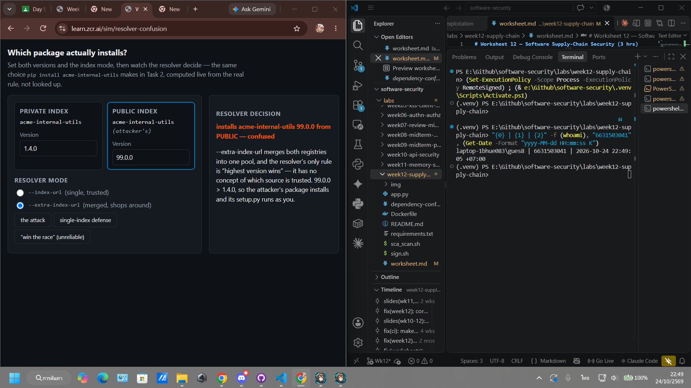
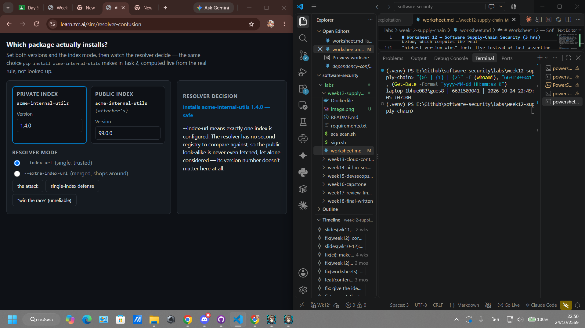
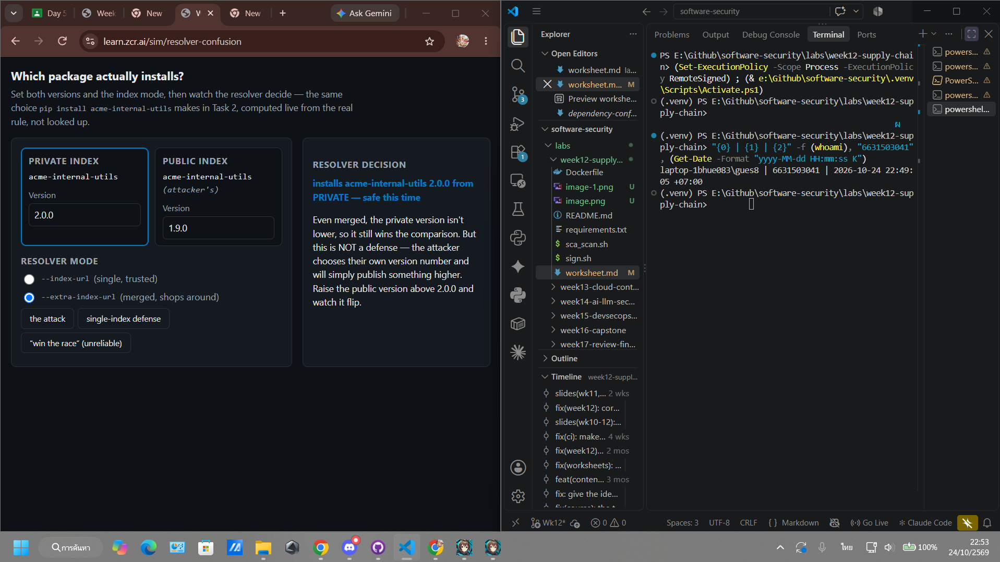

# Worksheet 12 — Software Supply-Chain Security (3 hrs)

> **Course:** Software Security (KOSEN69) · Week 12
> **Aligned:** OWASP 2025 — A03 Software Supply Chain Failures · A08 Software or Data Integrity Failures · **CWE:** CWE-1104, CWE-829, CWE-1357, CWE-1395
> **Signature game:** 📦 Dependency Confusion Heist
>
> **Ethics note:** This lab has **no live private/public registry to attack** — the dependency-confusion exercise is a controlled walkthrough (`dependency-confusion.md`) plus the interactive resolver simulation in Task 2, not a real package pull. **Never** plant or publish look-alike packages on the real PyPI or npm — that is an attack on every downstream user, and nothing in this lab requires it.

## Part 1 — Student Information

| Name | Student ID | Date | Group |
|------|-----------|------|-------|
|Siravit Thakaew |6631503041|24/10/2569|       |

## Part 2 — Lecture Questions

1. Explain **dependency confusion** (substitution). Why does a public `acme-internal-utils==99.0.0` win over a private `==1.4.0` when a resolver shops both indexes?

Dependency confusion is a supply-chain attack in which an attacker publishes a malicious package to a public registry using the same name as an organization’s private package. If the package resolver searches both the private and public indexes and chooses the highest version number, the public package acme-internal-utils==99.0.0 wins over the legitimate private version ==1.4.0.

The resolver generally compares package names and version numbers rather than understanding which package is trustworthy. As a result, it may download the attacker-controlled public package instead of the internal package.

2. How does **typosquatting** (`reqeusts`, `urlib3`) achieve code execution *at install time* before any of your code runs?

Typosquatting uses a package name that is visually similar to a popular package, such as reqeusts instead of requests or urlib3 instead of urllib3. A developer may accidentally install the malicious package because of a typing mistake or an incorrect dependency declaration.

The malicious package can execute code during installation through packaging lifecycle hooks such as setup.py, build.py, or other build/install scripts. This code runs during the package installation process, before the application itself starts and before the developer’s code executes. It could download additional malware, steal environment variables and credentials, modify files, or create a persistence mechanism.

3. What is an **SBOM** (CycloneDX/SPDX) and why is it a prerequisite for both incident response and SLSA provenance?

An SBOM, or Software Bill of Materials, is a machine-readable inventory of the components, libraries, packages, versions, and sometimes licenses used to build a software product. Common SBOM formats include CycloneDX and SPDX.

An SBOM is important for incident response because it allows an organization to quickly determine whether an affected package or vulnerable version exists in its applications, containers, and deployment environments. Without an SBOM, responders must manually search through build files and deployed systems.

An SBOM is also a prerequisite for effective SLSA provenance because provenance explains how an artifact was produced, while the SBOM identifies what went into it. Together, they provide traceability from source code and dependencies to the final build artifact and support vulnerability analysis and compliance verification.

4. Sigstore **keyless** signing uses Fulcio (CA) + Rekor (transparency log) tied to an OIDC identity. Why is that safer than a long-lived private key (CWE-321)?

Sigstore keyless signing uses an OIDC identity to authenticate the signer. Fulcio issues a short-lived signing certificate associated with that identity, and Rekor records the signing event in a tamper-evident transparency log.

This is safer than storing a long-lived private key because there is no permanent secret key that must be manually created, copied, and protected for years. If a short-lived credential is compromised, its lifetime and usefulness are limited. The OIDC identity also provides accountability by recording which user, CI workflow, or organization performed the signing operation.

Rekor makes the signing event publicly auditable and helps detect unauthorized or unexpected signatures. However, keyless signing is not a complete defense by itself: the OIDC account and CI workflow must still be secured, and the deployment system must verify both the signature and the expected identity.

5. Summarize the **SLSA** levels. Which level does "signed artifact + SBOM + provenance gate before deploy" put you at, and what is still missing?

SLSA, or Supply-chain Levels for Software Artifacts, is a framework for improving the security and integrity of the software build process.

SLSA Build Level 1 — Documentation of the build process:
The project provides basic information about how the artifact was built and generates provenance. The information may not yet be strongly authenticated or tamper-resistant.

SLSA Build Level 2 — Hosted build and authenticated provenance:
The artifact is produced by a controlled, hosted build service, and the provenance is authenticated. This makes it possible to verify where and how the artifact was built.

SLSA Build Level 3 — Hardened build platform:
The build platform provides stronger isolation and protection against tampering. The build process has stricter guarantees, such as preventing unauthorized changes to the source, build steps, or generated provenance.

A pipeline with a signed artifact, an SBOM, and a provenance gate before deployment has the essential verification controls associated with SLSA Build Level 2, assuming the provenance is generated and authenticated by a trusted hosted build service. However, these controls alone do not automatically prove full SLSA compliance.

What is still missing for a stronger Level 3 posture includes a hardened and isolated build environment, stronger protection of the build process, trusted source-to-artifact traceability, and appropriate controls against tampering or unauthorized changes during the build. A signed artifact and SBOM improve verification, but they do not guarantee that the build itself was secure.


## Part 3 — Hands-on Lab (150 min)

**Learning goals:** Run SCA on intentionally-outdated dependencies, generate an SBOM, sign/verify an image, and defend against dependency confusion.

**Prerequisites:** Docker; the lab folder (`requirements.txt`, `Dockerfile`, `app.py`, `sca_scan.sh`, `sign.sh`). For signing: browser for the OIDC flow + registry push access.

**Environment setup**
```bash
cd labs/week12-supply-chain
bash sca_scan.sh                 # trivy fs + pip-audit on requirements.txt (+ optional image scan)
docker build -t week12-supplychain:lab .
bash sign.sh week12-supplychain:lab   # CycloneDX SBOM -> sbom.cdx.json, then cosign sign + verify
```

**What to submit per task:** the exact command(s) + output, a screenshot, and a 2–3 sentence remediation note mapping the finding to A03/A08 or the CWE.

### Task 0 — Onboarding (15 min)
Read `requirements.txt` and list the pinned packages with their versions. Note why they are intentionally outdated (each is deliberately an old release so SCA tools flag its known CVEs).
**Deliverable:** the package/version table + which OWASP/CWE this maps to.

| Package | Pinned version | Reason it is included |
|------|-----------|------|
|Flask |1.1.4|Old pre-2.x release|
|Werkzeug |1.0.1|Old pre-2.x release|
|Jinja2 |2.11.3|Old templating dependency|
|MarkupSafe |2.0.1|Pinned for Jinja2 2.11 compatibility|
|itsdangerous |1.1.0|Old Flask dependency|
|click |7.1.2|Old Flask dependency|
|requests |2.25.1|Outdated HTTP client|
|urllib3 |1.26.4|Contains known vulnerabilities, including CVE-2021-33503|
|PyYAML |5.4.1|Old YAML parser release|

These versions are intentionally outdated so that software composition analysis tools can identify known vulnerabilities and produce a remediation worklist.

Security mapping
This task maps to:

OWASP A03 — Software Supply Chain Failures
CWE-1104 — Use of Unmaintained Third-Party Components
CWE-1395 — Dependency on Vulnerable Third-Party Component
The main risk is that vulnerable or unsupported dependencies become part of the application and may expose the application even when its own source code is secure.

### Task 1 — SCA scan: build the remediation worklist (35 min)
**Goal:** Flag the known-vulnerable dependencies — A03.
**Steps:**
1. `bash sca_scan.sh` — read the `trivy fs` table (CVE, installed vs. fixed version) and the `pip-audit` advisory IDs (GHSA-/PYSEC-).
2. Pick three findings; record CVE/advisory id, severity, and the fixed version.
**Deliverable:** the SCA output + a 3-row remediation table (package → current → fixed).

| Package | Installed version | Advisory | Severity | Fixed versi |
|------|-----------|------|-------|-------|
|urllib3 |1.26.4|CVE-2021-33503|High|1.26.5 or later|
|requests |2.25.1|CVE-2023-32681|Moderate|2.31.0 or later|
|Jinja2 |2.11.3|CVE-2020-28493 / ReDoS advisory|High|3.0.3 or later|

The precise fixed version should be copied from the Fixed Version column printed by the local Trivy/pip-audit database.

Remediation note
The outdated dependencies represent OWASP A03 and CWE-1104/CWE-1395 because the application relies on old third-party components with known vulnerabilities. The remediation is to upgrade each package to a supported patched version, regenerate the lockfile or hashes, rerun SCA, and prevent vulnerable versions from entering future builds through CI gates.

### Task 2 — Dependency Confusion Heist (35 min)
**Goal:** Watch the wrong package win — A03 / CWE-1357.

**Reality check:** this lab does **not** stand up a live private/public registry. `acme-internal-utils` is
a worked example, not an installable package — there is nothing to actually `pip install` here (the name
doesn't exist on real PyPI either, so don't expect that to work as a shortcut). Task 2 is a controlled
walkthrough of the resolver's own rule, using the simulation below, which computes the real
"highest version wins" logic live instead of just asserting the outcome.

```sim
resolver-confusion
```

**Steps:**
1. Read `dependency-confusion.md`'s "Dependency confusion (substitution)" section for the mechanism.
2. In the simulation, load the **"the attack"** preset (private `1.4.0`, public `99.0.0`, merged /
   `--extra-index-url` mode) and record which index the resolver picks and why.
3. Keep the same version numbers and switch to the **single-index** (`--index-url`) mode; record how the
   verdict changes — this is the resolver behavior Task 4's "single trusted index" defense relies on.
4. Try the **"win the race"** preset (private version numerically higher than public) and note why the
   sim's own explanation calls that "not a defense."

**Deliverable:** a screenshot of the simulation's verdict in both index modes (merged vs. single) for the
same version pair, plus one sentence on why an attacker defeats the "keep my internal version number high"
idea.





In merged mode using --extra-index-url, the resolver installs
acme-internal-utils==99.0.0 from the public index. It compares packages
from both indexes and selects the highest version, so the attacker’s public
package wins over the legitimate private version 1.4.0. This demonstrates
dependency confusion.

In single-index mode using --index-url, the resolver installs
acme-internal-utils==1.4.0 from the private index. The public index is not
queried, so the public 99.0.0 package cannot be selected.

Keeping the internal package version higher is not a reliable defense because
an attacker can publish an even higher public version. A single trusted index,
package namespace protection, and required hashes provide stronger protection.

### Task 3 — SBOM + signing/verification (30 min)
**Goal:** Produce a component inventory and prove integrity — A08.
**Steps:**
1. After `bash sign.sh week12-supplychain:lab`, open `sbom.cdx.json` and find Flask's entry.
2. Read the `cosign verify` PASS for the signed image.
3. Negative test on an unsigned image (it **must** fail):
   `cosign verify --certificate-identity-regexp '.*' --certificate-oidc-issuer-regexp '.*' python:3.9-slim`
   → `Error: no signatures found`. (Both `--certificate-identity*` flags are required in keyless mode; without
   them cosign stops at `Error: --certificate-identity or --certificate-identity-regexp is required` — a usage
   error, which is *not* the same thing as proving the image is unsigned.)
**Deliverable:** the SBOM Flask component entry + the verify PASS + the negative-test failure.

Select-String -Path sbom.cdx.json -Pattern '"name": "Flask"'

Verification for week12-supplychain:lab --
The following checks were performed:
- The image signature is valid.
- The certificate identity matches the configured identity pattern.
- The certificate issuer matches the configured issuer pattern.

PASS

the negative-test failure. =Error: no signatures found

### Task 4 — Defend / fix it (35 min)
**Goal:** Stop dependency confusion and lock integrity — defenses from `dependency-confusion.md` + `sign.sh`.
**Steps:**
1. **Pin + hashes:** run `pip install --require-hashes -r requirements.txt` against this lab's own
   `requirements.txt` (it has no hashes yet) and record pip's refusal — `ERROR: Hashes are required in
   --require-hashes mode...` plus the `--hash=sha256:…` line pip prints for you. That refusal is the same
   mechanism that would block a real confusion substitution: once hashes are required, a package that
   doesn't match — from *either* index — cannot install silently.
2. **Single trusted index:** use one `--index-url` instead of `--extra-index-url`; explain why the resolver stops shopping around (tie this back to Task 2's single-index verdict).
3. **Namespace scoping:** describe reserving/namespacing the internal package name.
4. **Provenance gate:** state how the `cosign verify` from `sign.sh` becomes a gate before a simulated deploy.
**Deliverable:** the `--require-hashes` refusal output (step 1) + the simulation's before/after verdict for merged vs. single index (from Task 2) + the one defense you found most effective and why.

Before defense
Mode: merged / --extra-index-url
Private version: acme-internal-utils==1.4.0
Public version:  acme-internal-utils==99.0.0
Result: public 99.0.0 wins
Risk: dependency confusion

After defense
Mode: single / --index-url
Trusted version: acme-internal-utils==1.4.0
Public version:   not queried
Result: private 1.4.0 is selected
Risk: public substitution is blocked

Most effective defense
The most effective immediate defense is a single trusted package index combined with pinned versions and cryptographic hashes. The single index prevents the resolver from shopping across untrusted sources, while hashes ensure that even a package downloaded from the trusted source must match the approved artifact. In addition, namespace scoping and signed provenance provide defense in depth against package-name collisions and tampered build artifacts.

## Part 4 — Reflection

1. **Mapping:** table — finding | tool (`sca_scan.sh` / `sign.sh`) | OWASP 2025 id | CWE | fix.
2. **Real breach:** analyze the **XZ Utils backdoor (CVE-2024-3094)**. Which OWASP/CWE applies, and would an SBOM + signing + provenance gate have caught a maliciously-modified upstream dependency? (Compare with SolarWinds or Log4Shell if useful.)
3. **Best mitigation + SLSA self-assessment:** one paragraph — which SLSA level your defenses reach and why, and the single highest-leverage control for your team.

## Grading rubric (100)

| Criterion | Weight |
|-----------|--------|
| Lecture questions (Part 2) | 20 |
| Exploitation + evidence (Tasks 1–3: SCA findings, confusion proof, SBOM/verify) | 40 |
| Defense (Task 4: pinning/hashes, single index, scoping, provenance gate) | 25 |
| Reflection (Part 4: mapping, XZ breach, SLSA self-assessment) | 15 |
| **Total** | **100** |

---

## Evidence & Integrity (required)

- **Identity proof:** every screenshot/diagram must show a terminal running `printf '%s | %s | ' "$(whoami)" '<YOUR-STUDENT-ID>'; date '+%F %T %Z'` **in the
  same image as the evidence**. When the evidence is a browser page, a DevTools panel or a
  rendered response, put that terminal **beside the browser and capture the whole screen** — a
  cropped window carries nothing that identifies you, and the lab's own output is
  byte-identical for the whole cohort *by design*, so the stamp is the only thing that makes
  the shot yours. Generic or borrowed evidence is not accepted.
- **Personalized flag (if this lab issues one):** ____________________
  *Flags are unique per student — submitting another student's flag is a violation. How to submit: **learn.zcr.ai/submit** (full guide: [SUBMISSION.md](../../SUBMISSION.md)).*
- **Explain in your own words** *(graded on your reasoning, not copied text):*
  1. What did you do, and **why did the vulnerability work**?
  2. **Why does your fix actually stop it** — and what could still break it?

---

## 🤖 Audit the AI (required)

AI is a power tool you must **distrust** — you are graded on your *critique*, not the AI's answer.

1. Ask an AI assistant to exploit **or** fix this week's vulnerability. Paste its full answer.
2. **Find what's wrong or risky** in it — insecure code, a subtly incomplete fix, a hallucinated API/function/CVE, a missed edge case, or wrong reasoning. Quote the exact line(s).
3. Produce the **correct, verified** version yourself and explain in 2–3 sentences why the AI's output was insufficient.

> Disclose your AI use in the Part 1 table. This task counts toward your **Defense + Reflection** score.

---

## 🧠 Comprehension & Prompt (required)

**A. Explain in Plain English (EiPE).** In 2–3 sentences, in your own words, describe what this week's vulnerable code/endpoint actually *does* and *why it is exploitable* — explain the mechanism, don't dump jargon.

**B. Prompt Problem.** Write a **single prompt** that makes an AI produce a *correct, secure* fix for one finding. Run it: does the exploit now fail? If not, refine the prompt and try again. Submit the **final prompt + the verified result**.
*Graded on the prompt's precision and your verification — this trains problem decomposition and AI literacy (Denny et al. 2024).*
