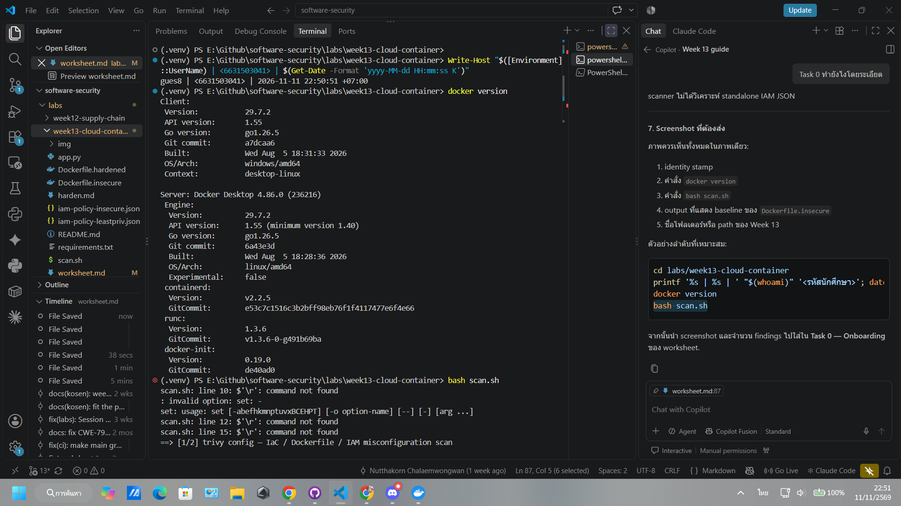
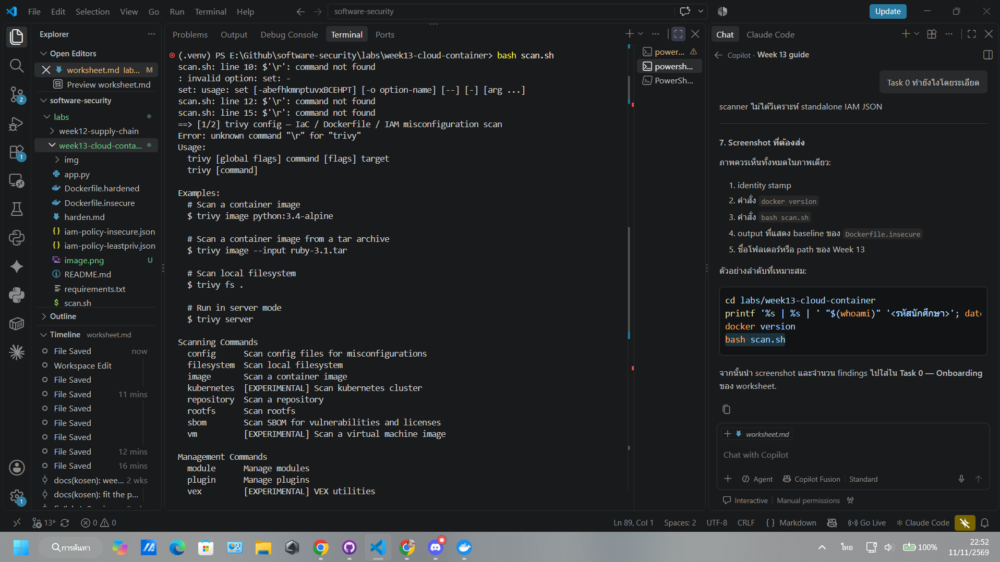
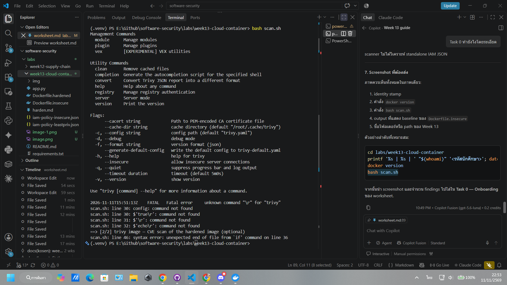
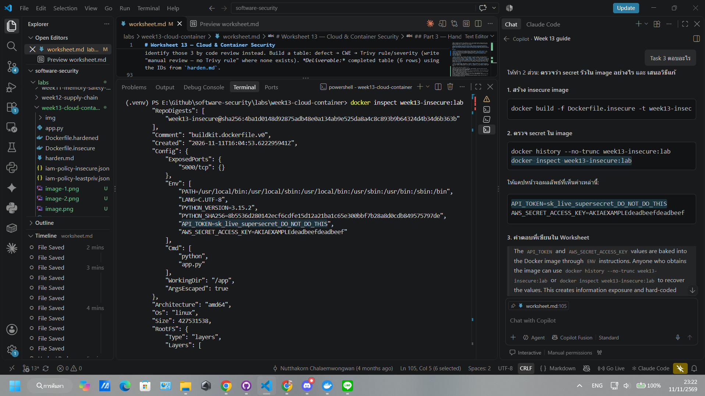

# Worksheet 13 — Cloud & Container Security

> **Course:** Software Security (KOSEN69) · Week 13
> **Aligned to:** OWASP 2025 **A02 Security Misconfiguration** · **CWE-732** (incorrect permission assignment), **CWE-16** (configuration), **CWE-526** (secret exposed through an environment variable), plus CWE-798 (hard-coded credential — OWASP files this under **A07**), CWE-250, CWE-538, CWE-269, CWE-1104
> **Signature game:** 🔍 *Misconfig Hunt* (CloudGoat-style) — each misconfig you find **and** fix = a flag.

> ⚠️ **Ethics note:** All artifacts here are deliberately broken for teaching and are marked *"Sandbox/teaching only; for authorized lab use."* Scan, exploit, and harden **only** these lab files (or systems you own / are authorized to test). Never point Trivy or these techniques at third-party cloud accounts or images without written permission.

---

## Part 1 — Student Information

| Name | Student ID | Date | Group |
|------|-----------|------|-------|
|Siravit Thakaew|6631503041|11/11/2569|Tha-krit-ok|

---

## Part 2 — Lecture Questions

Answer in your own words (2–4 sentences each).

1. Explain the **shared-responsibility model**. In `harden.md` it says "the cloud provider secures *of* the cloud; you secure what you put *in* it." Give one concrete example of each side for an S3-backed app.

Cloud provider รับผิดชอบความปลอดภัย “of the cloud” เช่น ความปลอดภัยของศูนย์ข้อมูล ฮาร์ดแวร์ และระบบพื้นฐาน ส่วนผู้ใช้รับผิดชอบสิ่งที่นำไปวาง “in the cloud” เช่น IAM, bucket permission และข้อมูลใน S3 สำหรับ S3-backed app ผู้ให้บริการดูแลระบบ S3 ส่วนเราต้องตั้ง bucket ให้ private และจำกัดสิทธิ์ IAM

2. `iam-policy-insecure.json` uses `"Action": "*"` and `"Resource": "*"`. Describe **why this violates least privilege** and map it to CWE-732 vs CWE-269 — what is the difference between the two CWEs here?

Policy นี้อนุญาตให้ทำได้ทุก action กับทุก resource จึงขัดกับหลัก least privilege เพราะบัญชีมีสิทธิ์เกินกว่างานที่จำเป็น CWE-269 คือการจัดการ privilege ไม่เหมาะสม เช่น ให้สิทธิ์ระดับ admin โดยไม่จำเป็น ส่วน CWE-732 คือการกำหนด permission ให้ resource กว้างหรือผิด เช่น Resource: "*"

3. The insecure Dockerfile bakes `ENV API_TOKEN=sk_live_...`. Explain how an attacker recovers that secret from a shipped image (name the `docker` commands) and why this is **CWE-526 / CWE-798 / CWE-200**.

ผู้โจมตีที่ได้ image สามารถใช้ docker history --no-trunc <image> เพื่อดูคำสั่งและค่า ENV หรือใช้ docker inspect <image> เพื่อดู environment variables ได้ Secret จึงถูกเปิดเผยใน image และอาจถูกคัดลอกต่อไปเรื่อย ๆ ซึ่งเกี่ยวข้องกับ CWE-526, CWE-798 และ CWE-200 ควร inject secret ตอน runtime ผ่าน secrets manager หรือ mounted secret

4. Why is `FROM python:latest` (CWE-1104/CWE-16) a security and reproducibility problem, and how does pinning to an `@sha256:` digest fix it?

Tag latest เปลี่ยนได้ตลอด ทำให้ build แต่ละครั้งอาจได้โค้ดและช่องโหว่ไม่เหมือนกัน อีกทั้งอาจดึงเวอร์ชันที่ไม่ผ่านการทดสอบ การ pin ด้วย @sha256:<digest> ทำให้ใช้ image เดิมที่ตรวจสอบย้อนกลับได้ เพิ่มทั้งความปลอดภัยและ reproducibility

5. What does a **distroless** base image remove (relative to `python:3.11-slim`), and how does that shrink the attack surface for an RCE or container-escape attacker?

Distroless มักไม่มี shell, package manager, utilities และไฟล์ระบบที่ไม่จำเป็น เมื่อเทียบกับ python:3.11-slim จึงมี component และ attack surface น้อยกว่า หากเกิด RCE ผู้โจมตีจะมีเครื่องมือให้ใช้ต่อยอดน้อยลง และการรันด้วย non-root ช่วยลดผลกระทบหาก container ถูกเจาะสำเร็จ

---

## Part 3 — Hands-on Lab (120 min in class + 60 min homework)

> **In class or homework.** Tasks marked *in class* are done during the lab, where the instructor
> checks your evidence and reasoning. Tasks marked *homework* are finished after class and submitted
> with the rest of this worksheet, before the next class. Every task keeps its time and its marks.
> Answer Part 2 before class, from this week's slides; Part 4, *Audit the AI* and *Comprehension &
> Prompt* are homework.
>
> **Before class (15 min):** Task 0 · **In class (120 min):** Tasks 1, 2 and 4 · **Homework (45 min):** Tasks 3 and 5
>
> Run Task 0's baseline scan before class, so the lab starts on Task 1.

**Learning goals:** find cloud/container misconfigurations with Trivy, map each to a CWE, and rebuild the IAM policy + Dockerfile to least privilege / hardened so the findings drop.

**Prerequisites:** Docker installed and running; the `week13-cloud-container/` lab folder; internet access to pull `aquasec/trivy:latest`.

### Environment setup (real commands)

```bash
cd labs/week13-cloud-container

# Option A — the provided wrapper (trivy config over the Dockerfiles; IAM JSON is reviewed manually, see Task 2):
bash scan.sh

# Option B — run Trivy directly (MEDIUM is in the filter on purpose: one of the
# three rules Task 1 asks you to cite is rated MEDIUM, and HIGH,CRITICAL hides it):
docker run --rm -v "${PWD}:/src" aquasec/trivy:latest config --severity MEDIUM,HIGH,CRITICAL /src

# Build the insecure image too — Task 3 inspects it:
docker build -f Dockerfile.insecure -t week13-insecure:lab .

# (Optional) build + CVE-scan the hardened image:
docker build -f Dockerfile.hardened -t week13-hardened:lab .
docker run --rm -v /var/run/docker.sock:/var/run/docker.sock aquasec/trivy:latest image --severity HIGH,CRITICAL week13-hardened:lab
```

**What to submit per task:** the command(s) you ran + the relevant output (finding count or the specific finding line), a screenshot of the Trivy/terminal result, and a 2–3 sentence mitigation explaining *why* the fix reduces risk (cite the CWE).


### Tasks

- **Task 0 — Onboarding (15 min, before class).** Confirm Docker works (`docker version`), run `bash scan.sh`, and record the **baseline finding count** against `Dockerfile.insecure` (Trivy's `config` scanner does not parse standalone IAM policy JSON, so `iam-policy-insecure.json` is reviewed manually instead — see Task 2). **Deliverable:** screenshot of the baseline scan.ฃ




- **Task 1 — Misconfig Hunt: container image (40 min, in class).** *Goal:* find every defect in `Dockerfile.insecure`. *Steps:* read each `# DEFECT:` comment, then locate the matching Trivy finding where one exists — only 3 of the 6 (unpinned `:latest`, runs as root, secrets in `ENV`) map to a Trivy config rule (`DS-0001`, `DS-0002`, `DS-0031`); `COPY . .`, `chmod -R 777`, and unpinned `pip install` are instruction-level RUN/COPY semantics Trivy's Dockerfile scanner doesn't check, so identify those 3 by code review instead. Build a table: defect → CWE → Trivy rule/severity (write "manual review — no Trivy rule" where none exists). *Deliverable:* completed table (6 rows) using the IDs from `harden.md`.

- **Task 2 — Misconfig Hunt: IAM (30 min, in class).** *Goal:* document why `iam-policy-insecure.json` is full-admin. *Steps:* identify the `Action:*` / `Resource:*` / no-`Condition` problems; map to CWE-269 / CWE-732. *Deliverable:* 3-row table + one sentence on the blast radius if these creds leak.

| Defect | CWE | Trivy rule / Severity | fix |
|------|-----------|------|-------|
|FROM python:latest uses a mutable tag.|CWE-1104, CWE-16|DS-0001 / Check the severity from the output|Pin using the version and SHA-256 digest|
|Store API_TOKEN and AWS secret in ENV|CWE-526, CWE-798, CWE-200|DS-0031 / Check the severity from the output|Inject secrets at runtime|
|COPY . . Copies the entire build context|CWE-538|Manual review — No Trivy rules in this lab|Copy only the necessary files and use them.|
|chmod -R 777 /app|CWE-732|Manual review — No Trivy rules in this lab|Tha-krit-ok|
|No USER is specified, causing the container to run as root.|CWE-250|DS-002 / Check Severity from the output|Use only the necessary permissions.|
|Install dependencies without strict pinning/hashing|CWE-1104|Manual review — No Trivy rules in this lab|Pin package versions และ|

- **Task 3 — Secrets & storage (25 min, homework).** *Goal:* show secrets must not live in the image. *Steps:* explain how `ENV API_TOKEN` / `AWS_SECRET_ACCESS_KEY` are exposed via `docker history --no-trunc week13-insecure:lab` (or `docker inspect`); propose where they belong instead (secrets manager / mounted secret / orchestrator secret per `harden.md`). *Deliverable:* 2–3 sentence remediation + the `.dockerignore` entries you would add to stop `COPY . .` leaking `.git`/`.env` (CWE-538).
docker build -f Dockerfile.insecure -t week13-insecure:lab 
docker history --no-trunc week13-insecure:lab
docker inspect week13-insecure:lab

The API_TOKEN and AWS_SECRET_ACCESS_KEY values are baked into the Docker image through ENV instructions. Anyone who obtains the image can use docker history --no-trunc week13-insecure:lab or docker inspect week13-insecure:lab to recover the values. This creates information exposure and hard-coded credential risks under CWE-526, CWE-798, and CWE-200. Secrets should instead be injected at runtime using a cloud secrets manager, Docker/Kubernetes secrets, or a mounted secret file, and exposed credentials should be rotated.

- **Task 4 — Hardened-Dockerfile + least-priv-IAM defense (50 min, in class).** *Goal:* prove the "after" is clean. *Steps:* (a) re-run `bash scan.sh` (or `trivy config`) against `Dockerfile.hardened` and capture the **reduced** finding count (Trivy's config scanner does not parse standalone IAM JSON, so confirm the IAM fix manually per Task 2 by diffing `iam-policy-leastpriv.json` against the insecure policy); (b) for the Dockerfile, point to the fix for each Task-1 defect (digest pin, multi-stage venv, distroless runtime, `USER 65532:65532`, no secrets in `ENV`, copy only `app.py`); (c) for IAM, confirm the rewrite scopes `s3:GetObject` to `arn:aws:s3:::lab-app-bucket/app/*` and adds the `s3:prefix` `Condition`; (d) list the extra runtime flags from `harden.md` (`--read-only`, `--cap-drop ALL`, `--security-opt no-new-privileges`). *Deliverable:* before/after finding counts, the defect→fix mapping, and the diffed policy/Dockerfile with one sentence per fix.

The hardened Dockerfile reduced the Trivy configuration findings from the insecure baseline to 0 for the hardened file. It uses immutable image digests, a multi-stage build, a distroless runtime, a non-root user, no baked-in secrets, and copies only required files. The IAM policy also follows least privilege by limiting actions, resources, and the S3 prefix condition.

- **Task 5 — Flag tally (20 min, homework).** *Goal:* score the hunt. *Steps:* one flag per misconfig found **and** fixed (6 container + 3 IAM = 9). *Deliverable:* flag count + the single biggest-risk misconfig and why.

I earned 9 flags in total: 6 container misconfigurations and 3 IAM misconfigurations. The container issues were the mutable latest tag, secrets in ENV, COPY . ., world-writable permissions, running as root, and unpinned dependencies. The IAM issues were wildcard actions, wildcard resources, and the missing Condition.

The biggest-risk misconfiguration was the IAM policy with "Action": "*" and "Resource": "*". If the credentials leaked, an attacker could access or modify almost every AWS resource. Restricting access to s3:GetObject, one bucket prefix, and an s3:prefix condition greatly reduces the blast radius.

---

## Part 4 — Reflection

1. **Mapping.** For three findings, write the line of the artifact → CWE → OWASP 2025 A02, and the one-line fix.
2. **Real incident.** Briefly describe a real breach caused by a cloud/container misconfiguration (e.g., a public S3 bucket leak, or an over-permissive IAM role). What single control from this lab would have prevented it?
3. **Best mitigation.** Of everything you did, which control gives the most risk reduction per unit of effort, and why? Argue for least-privilege IAM vs. distroless+non-root.

---

## Grading rubric (100)

| Component | Points | What earns full marks |
|-----------|:------:|-----------------------|
| Part 2 — Lecture questions | 20 | All 5 answered correctly with CWE/A02 reasoning |
| Part 3 — Tasks + evidence | 40 | Tasks 0–5 complete; commands, outputs, and screenshots present |
| Defense (Task 4 hardening) | 25 | Hardened Dockerfile + least-priv IAM shown to reduce findings; per-fix justification |
| Part 4 — Reflection | 15 | Accurate mapping, relevant incident, well-argued best mitigation |

**Due:** 23:59 (Thai time) the night before next week's class (exact time on learn.zcr.ai/submit). **Late:** −10% per started day; 0 after 10 days.

---

## Evidence & Integrity (required)

- **Identity proof:** every screenshot/diagram must show a terminal running `printf '%s | %s | ' "$(whoami)" '<YOUR-STUDENT-ID>'; date '+%F %T %Z'` **in the
  same image as the evidence**. When the evidence is a browser page, a DevTools panel or a
  rendered response, put that terminal **beside the browser and capture the whole screen** — a
  cropped window carries nothing that identifies you, and the lab's own output is
  byte-identical for the whole cohort *by design*, so the stamp is the only thing that makes
  the shot yours. Generic or borrowed evidence is not accepted.
- **Personalized flag (if this lab issues one):** ____________________
  *Flags are unique per student — submitting another student's flag is a violation. How to submit: **learn.zcr.ai/submit** (full guide: [SUBMISSION.md](../../SUBMISSION.md)).*
- **Explain in your own words** *(graded on your reasoning, not copied text):*
  1. What did you do, and **why did the vulnerability work**?
  2. **Why does your fix actually stop it** — and what could still break it?

---

## 🤖 Audit the AI (required)

AI is a power tool you must **distrust** — you are graded on your *critique*, not the AI's answer.

1. Ask an AI assistant to exploit **or** fix this week's vulnerability. Paste its full answer.
2. **Find what's wrong or risky** in it — insecure code, a subtly incomplete fix, a hallucinated API/function/CVE, a missed edge case, or wrong reasoning. Quote the exact line(s).
3. Produce the **correct, verified** version yourself and explain in 2–3 sentences why the AI's output was insufficient.

> Disclose your AI use in the Part 1 table. This task counts toward your **Defense + Reflection** score.

---

## 🧠 Comprehension & Prompt (required)

**A. Explain in Plain English (EiPE).** In 2–3 sentences, in your own words, describe what this week's vulnerable code/endpoint actually *does* and *why it is exploitable* — explain the mechanism, don't dump jargon.

**B. Prompt Problem.** Write a **single prompt** that makes an AI produce a *correct, secure* fix for one finding. Run it: does the exploit now fail? If not, refine the prompt and try again. Submit the **final prompt + the verified result**.
*Graded on the prompt's precision and your verification — this trains problem decomposition and AI literacy (Denny et al. 2024).*
